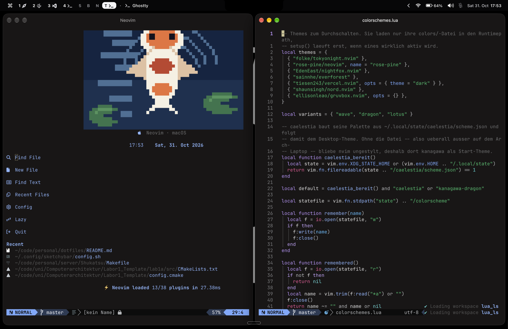

# Miracs Dotfiles

Meine macOS-Entwicklungsumgebung und System-Konfiguration für **Neovim**, **tmux**, **Zellij**, **AeroSpace** und **SketchyBar** (plus VSCodium-Settings) – jedes Modul lässt sich einzeln per `install.sh` installieren, unter macOS und Linux.

<p align="center">
  
</p>

## Inhalt

| Ordner       | Zielpfad                  | Beschreibung                                                                 |
| ------------ | ------------------------- | ---------------------------------------------------------------------------- |
| `nvim`       | `~/.config/nvim`          | Neovim-Konfiguration mit `lazy.nvim`, Snacks, `blink.cmp`, Mason & Pixel-Art |
| `tmux`       | `~/.config/tmux`          | tmux-Konfiguration mit Ukiyo-Statusleiste und interaktivem Theme-Menü        |
| `zellij`     | `~/.config/zellij`        | Zellij Terminal-Multiplexer Konfiguration (`config.kdl`)                     |
| `aerospace`  | `~/.aerospace.toml`       | AeroSpace Tiling Window Manager Konfiguration (`ctrl+alt` Keybindings)       |
| `sketchybar` | `~/.config/sketchybar`    | Minimalistische macOS Statusbar mit interaktiven Popups & Theme-Switcher     |
| `vscodium` | `…/VSCodium/User/settings.json` | VSCodium-Settings und Extension-Liste (macOS und Linux) |
| `tools`      | –                         | Generator für die Neovim-Dashboard-Motive                                    |

---

## Installation
Das Repo einmal klonen. Danach wählst du, **welche** Module du willst. Es wird nur verlinkt, was du angibst. Bestehende Configs werden vorher nach `~/.dotfiles-backup/` gesichert.

```sh
git clone https://github.com/Mirac61/dotfiles.git ~/dotfiles
cd ~/dotfiles
```

### Nur einzelne Module (z. B. nur Neovim)

Nur Neovim:

```sh
./install.sh nvim
```

Neovim und VSCodium:

```sh
./install.sh nvim vscodium
```

### Auswahlmenü

Module nummeriert auswählen, Enter wählt alle:

```sh
./install.sh
```

### Weitere Optionen

Alles verlinken, inklusive Homebrew-Pakete (nur macOS):

```sh
./install.sh --all
```

Alle Module verlinken, ohne Pakete:

```sh
./install.sh --link-only
```

### Module und Plattformen

| Modul        | macOS | Linux | Hinweis                                                           |
| ------------ | :---: | :---: | ----------------------------------------------------------------- |
| `nvim`       |   ✓   |   ✓   | Neovim selbst muss installiert sein (`brew`/Paketmanager)         |
| `tmux`       |   ✓   |   ✓   |                                                                   |
| `zellij`     |   ✓   |   ✓   |                                                                   |
| `vscodium`   |   ✓   |   ✓   | Verlinkt `settings.json`, installiert Extensions aus `extensions.txt`, falls `codium` im PATH ist |
| `aerospace`  |   ✓   |   –   | nur macOS                                                         |
| `sketchybar` |   ✓   |   –   | nur macOS                                                         |

VSCodium-Extensions neu exportieren:

```sh
codium --list-extensions > vscodium/extensions.txt
```

---
## SketchyBar

Minimalistische, schnelle macOS-Statusleiste passend zu AeroSpace:

- **`⌘`-Menü (oben links):** Direktes Umschalten zwischen Stilen (`Minimal Tint`, `Floating Glass`, `Split Capsules`) und Farbschemata (`Kanagawa Dragon`, `macOS Glass`, `Catppuccin Mocha`, `Tokyo Night`, `Rosé Pine Moon`) sowie Schnellzugriff auf `config.sh`.
- **Interaktive Popups:** Klick auf **WLAN** (IP kopieren, WLAN an/aus, Einstellungen), **Batterie** (Restlaufzeit & Stromquelle) oder **Kalender** (Wochenübersicht, Datum kopieren, Kalender-App).
- **CLI-Switcher:** `~/.config/sketchybar/switch_style.sh` zum Wechseln per Terminal.

---

## AeroSpace

Tiling Window Manager mit `ctrl+alt` als Haupt-Modifier (kollidiert nicht mit deutschen Sonderzeichen auf `alt`):

- `ctrl+alt+1..5` / `T` (Terminal) / `B` (Browser) / `N` (Notizen): Workspace wechseln
- `ctrl+alt+shift+1..5/T/B/N`: Fenster auf Workspace verschieben
- `ctrl+alt+h/j/k/l`: Fokus wechseln
- `ctrl+alt+enter`: Neues Ghostty-Fenster öffnen

---

## Neovim

Die Leader-Taste ist `Space`. Plugins liegen in `lua/plugins/`, eigene Tasten in
`lua/config/keymaps.lua`. Die Versionen sind in `lazy-lock.json` festgehalten.

| Taste        | Aktion                        |
| ------------ | ----------------------------- |
| `<leader>e`  | Datei-Explorer                |
| `<leader>ff` | Dateien suchen                |
| `<leader>fw` | Im Projekt suchen (Grep)      |
| `<leader>fb` | Offene Buffer                 |
| `<leader>fk` | Alle Tastenkürzel durchsuchen |
| `jk`         | Insert-Modus verlassen        |

Language Server (unter anderem `gopls`, `clangd`, `lua_ls`, `marksman`) werden
über Mason installiert. Zum Formatieren dient `conform.nvim`.

---

## tmux & Zellij

- **tmux:** Die Statusleiste liegt oben und nutzt das Plugin Ukiyo. Mit `prefix + T` öffnet sich das Theme-Menü (Vercel, Kanagawa, Tokyo Night, Nord, Gruvbox).
- **Zellij:** Konfiguriert in `zellij/.config/zellij/config.kdl` mit angepassten Keybindings und Theme-Support.

---

## Dashboard-Motive (Neovim)


Es gibt zwölf Motive im japanischen Nacht- und Schrein-Stil: Mond, Koi, Torii,
Pagode, Kirschblüten- und Gedenklaternen, Katzen, Higanbana, Bambuswald mit
Glühwürmchen, Kitsune-Maske und Samurai.

Pillow installieren:

```sh
python3 -m pip install Pillow
```

Motive generieren:

```sh
python3 tools/dashboard_art_gen.py
```
